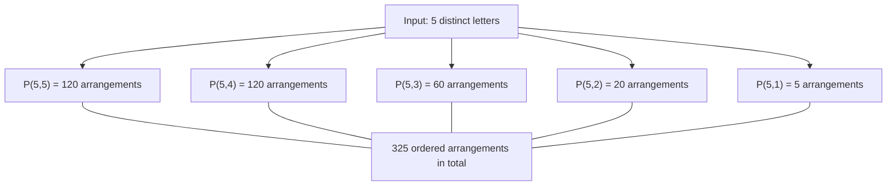
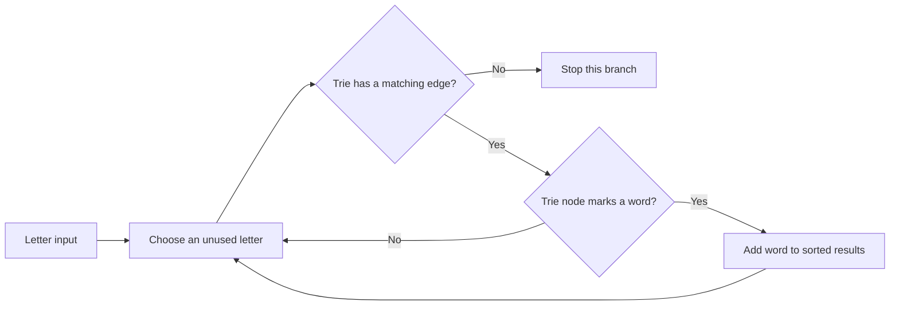

# WordCreator

[](https://github.com/BadBadDev/WordCreator/actions/workflows/build.yml)
[](LICENSE)

A small C# exercise in permutations and combinations, with a practical use: finding dictionary words that can be built from entered letters.

```text
$ dotnet run --project src/WordCreator.csproj

Type letters (or 'exit'): cat
Valid words: 4
act
at
cat
ta
```

## Educational purpose and limitations

This project is about practicing permutation and combination concepts in C#, not maximizing performance. The dictionary search gives the generated arrangements a purpose: it identifies which ones are words.

Without pruning, generating ordered arrangements of every length grows very quickly:

```text
Ordered arrangements:

n = 1:       1
n = 5:       5 + 20 + 60 + 120 + 120 = 325
n = 10:      ~9.86 million ordered arrangements through all lengths
n = 15:      ~3.55 trillion ordered arrangements through all lengths
n = 20:      ~6.61 quintillion ordered arrangements through all lengths

The sum grows as Σ P(n, r), r = 1..n
```

The number of ordered arrangements of length `r` is:

```text
P(n, r) = n! / (n-r)!
```

If order does not matter, the number of selections is:

```text
C(n, r) = n! / (r!(n-r)!)
       = P(n, r) / r!
```

For example, 5 distinct letters can produce:



At startup, the solver builds a trie: a tree whose paths share prefixes and whose nodes mark complete words. It generates arrangements recursively while walking this tree, stopping a branch as soon as its next letter has no matching path:



The trie shares prefixes and uses character-keyed lookups to prune branches that cannot form a word. Building it takes time and memory at startup; it is not saved between runs. The unpruned counts above show the factorial upper bound for distinct letters. Repeated letters can still produce duplicate candidates, although matching words appear only once in the results. Large inputs can still take a long time.

## Build and run

Requires the [.NET 10 SDK](https://dotnet.microsoft.com/download/dotnet/10.0).

```powershell
dotnet run --project src/WordCreator.csproj
```

Build the solution:

```powershell
dotnet build WordCreator.sln
```

## Dictionary

`src/dictionary.json` contains approximately 275,000 words. Confirm and preserve the original dictionary's license and attribution before redistributing or publishing derivative datasets. The application currently assumes lowercase ASCII dictionary entries.

## License

Licensed under the MIT License. See [LICENSE](LICENSE).